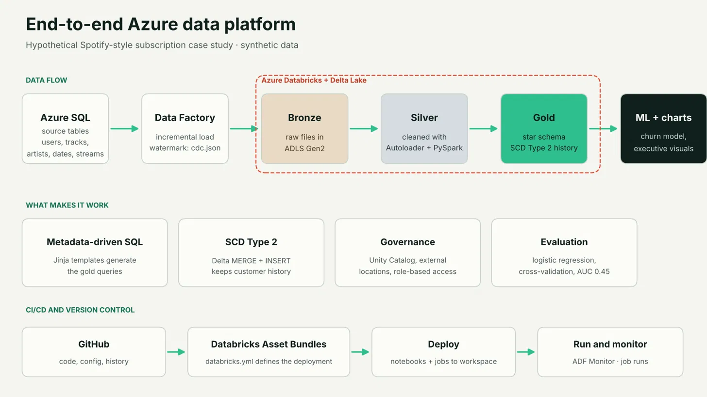
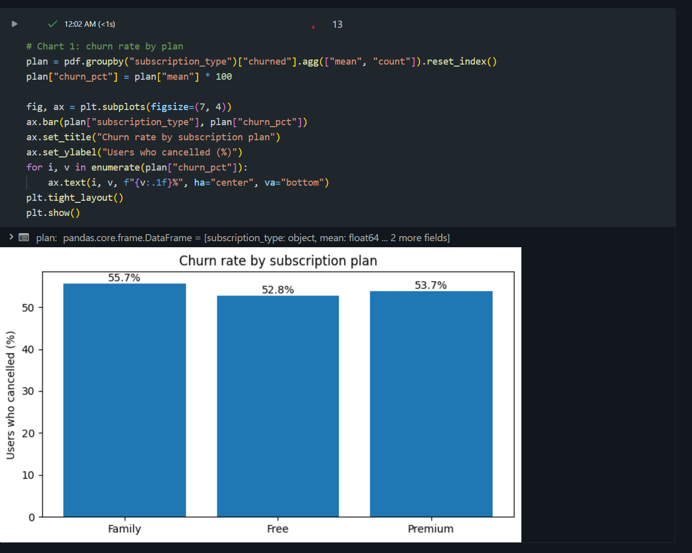
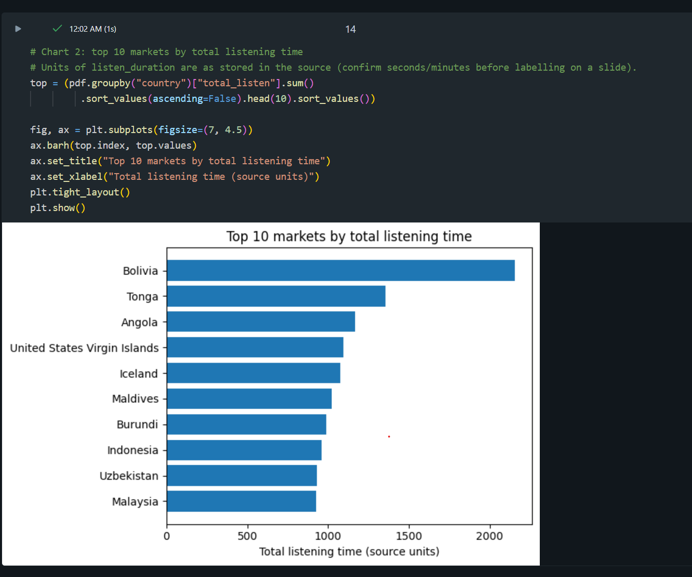
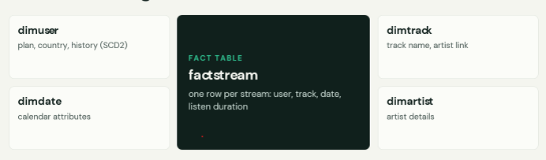

# Spotify-Style Subscription Analytics: End-to-End Azure Data Platform

An end-to-end data engineering and analytics project on Azure: incremental ingestion, a medallion lakehouse, a star schema with SCD Type 2 history, and a churn analysis for a **hypothetical** music-streaming subscription business.

> **Note:** The business is hypothetical and **all data is synthetic**. No real customer data was used.







## The business problem

A subscription business loses revenue when customers leave and wastes budget when marketing is aimed at the wrong markets. The questions this project answers:

1. Can customer behaviour predict who is likely to churn?
2. Which plans and markets deserve marketing focus?
3. Can one governed data platform serve both questions reliably?

## Architecture

| Layer | What happens | Tools |
|---|---|---|
| Source | Operational tables: users, tracks, artists, dates, streams | Azure SQL Database |
| Ingestion | Parameterised, incremental copy driven by a watermark (`cdc.json`) | Azure Data Factory (Lookup, ForEach, Copy) |
| Bronze | Raw files, unchanged | ADLS Gen2 |
| Silver | Cleaned, typed, deduplicated; streaming-style ingestion with Autoloader | Databricks, PySpark, Delta Lake |
| Gold | Star schema built from metadata-driven SQL | Jinja2, Delta Lake, Unity Catalog |
| Analytics | Churn model and executive charts | scikit-learn, matplotlib |

### Key engineering ideas

- **Incremental loading.** ADF reads the last watermark from `cdc.json`, copies only newer rows, then updates the watermark. `empty.json` (`{}`) is the starting state for a first full load.
- **Metadata-driven gold layer.** Jinja templates generate the gold SQL from a configuration list, so adding a table means adding config, not rewriting code.
- **SCD Type 2 on `dimuser`.** A Delta `MERGE` closes the old row (`__END_AT`) when plan or country changes, then an `INSERT` adds the new current row. History is preserved for point-in-time analysis.
- **Governance.** Unity Catalog with external locations, backed by an access connector. Catalog: `spotify_cata`, schema: `gold`.
- **Reusable transformations.** Shared PySpark logic lives in a `reusable` class (`utils/Transformations.py`).

## Churn analysis

- **Definition:** a user is churned if they have no streams after a cutoff date (70% of the stream history). Features come only from data **before** the cutoff, to avoid leakage.
- **Features:** tenure, plan, country, total streams, total listening time, average listening time, distinct tracks, days since last stream.
- **Model:** logistic regression (balanced class weights, scaling, one-hot encoding), evaluated with a held-out test set and 5-fold cross-validation.

| Metric | Result |
|---|---|
| Majority-class baseline | 53.8% |
| Test ROC AUC | 0.45 |
| 5-fold CV AUC | 0.49 ± 0.06 |
| Recall (churned) | 53.1% |
| Accuracy | 46.2% |

**Honest finding:** an AUC near 0.5 means the model is no better than chance. On this synthetic data, behaviour does not predict who leaves. The recommendation is therefore to **collect real cancellation data first** before investing in retention offers.

### Business insights from the charts

- Churn rate by plan is similar across plans (52.8% to 55.7%, Family highest).
- Bolivia, Tonga and Angola lead on listening time (units to be confirmed against the source data).
- K-means segmentation (4 clusters) groups users by engagement for targeted campaigns.

## Repository structure

```
.
├── images/                  architecture diagram and result charts
├── factory/                 Azure Data Factory definition (df-azureprojt)
├── pipeline/                ADF pipelines (incremental load, loop)
├── dataset/                 ADF datasets
├── linkedService/           ADF linked services (no secrets)
├── source_script/           source SQL scripts
├── silver_dimensions.ipynb  Databricks: Autoloader, silver layer
├── gold_layer.ipynb         Databricks: Jinja SQL, star schema, SCD2
├── 04_churn_ml_and_visuals.ipynb  churn model and charts
├── cdc.json / empty.json    incremental-load watermark files
├── pipeline.json            exported ADF pipeline
├── arm_template.zip         ARM template export
└── databricks.yml           Databricks Asset Bundle config (deployment)
```

## How to reproduce

1. Create an Azure SQL database and load the synthetic tables from `source_script/`.
2. Deploy the Data Factory (`factory/`, `pipeline/`) and point the linked services at your own SQL server and ADLS Gen2 account.
3. In Databricks, set up Unity Catalog with an external location for the storage account.
4. Run `silver_dimensions.ipynb`, then `gold_layer.ipynb`, then `04_churn_ml_and_visuals.ipynb`.


## Limitations and next steps

- Synthetic data and a small sample, so results are illustrative only.
- Churn is inferred from inactivity, not real cancellations.
- Delta Live Tables were not used (workspace storage credential limits); the pipeline uses notebooks and batch-style Autoloader.
- CI/CD is partial: the Databricks Asset Bundle config is included, but automated GitHub-to-Databricks deployment is a next step.
- Next: real cancellation data, real-time scoring with streaming, and tracking whether offers reduce churn.

## Responsible data use

Designed with UK GDPR principles in mind: data minimisation, pseudonymised names, role-based access, no sensitive attributes in the model, and human review before any customer-facing action.

## Skills demonstrated

SQL · Python · PySpark · Azure Data Factory · Azure Databricks · Delta Lake · ADLS Gen2 · Unity Catalog · Medallion architecture · Dimensional modelling (star schema, SCD2) · Jinja templating · scikit-learn · Data visualisation · Git

## Author

**Shangeeth Vanniyasingam** · https://www.linkedin.com/in/shangeeth-vanniyasingam-773029284/ · Open to graduate data engineering / data analytics roles in the UK.
